# 🏛️ Manual Oficial de Uso y Operación — Gubernator (`gbnt`) `v3.2.6`

[](https://github.com/gubernator-org/gubernator/releases)
[](https://gubernator-org.github.io/gubernator/)
[](https://github.com/gubernator-org/gubernator/blob/main/LICENSE)

**Gubernator (`gbnt`)** es un orquestador de contenedores híbrido escrito en Go que combina la **sencillez operativa de Docker Swarm** (soporte nativo para `docker-compose.yml` y unión inmediata de nodos) con la **flexibilidad de planificación de HashiCorp Nomad** (etiquetas de afinidad de hardware/GPU, almacenamiento distribuido, observabilidad SRE eBPF/Grafana/Loki/Jaeger y cumplimiento normativo empresarial DORA, NIS 2, ISO 27001, ENS y CIS Docker).

---

## 📑 Índice de Contenidos

1. [Arquitectura del Entorno en Vivo (Clúster de 2 Máquinas en el Host)](#1-arquitectura-del-entorno-en-vivo-clúster-de-2-máquinas-en-el-host)
2. [Instalación, Inicialización y Unión de Nodos (`gbnt legion`)](#2-instalación-inicialización-y-unión-de-nodos-gbnt-legion)
3. [Acceso al Dashboard Web y Control de Identidad](#3-acceso-al-dashboard-web-y-control-de-identidad)
4. [Vista General del Clúster (`Overview`)](#4-vista-general-del-clúster-overview)
5. [Gestión de Nodos del Clúster (`Centurions [Host]`)](#5-gestión-de-nodos-del-clúster-centurions-host)
6. [Despliegue de Stacks (`Legions`) y `Compose Studio`](#6-despliegue-de-stacks-legions-y-compose-studio)
7. [Gestión de Contenedores y Carga de Trabajo (`Containers`)](#7-gestión-de-contenedores-y-carga-de-trabajo-containers)
8. [Almacenamiento Persistente, GlusterFS y Backups (`The Granaries`)](#8-almacenamiento-persistente-glusterfs-y-backups-the-granaries)
9. [Seguridad de Imágenes, SBOM, Firma Cosign y Cumplimiento Normativo](#9-seguridad-de-imágenes-sbom-firma-cosign-y-cumplimiento-normativo)
10. [Ingress Multi-Nodo (`Caddy`) y Descubrimiento DNS (`CoreDNS`)](#10-ingress-multi-nodo-caddy-y-descubrimiento-dns-coredns)
11. [Observabilidad SRE: Grafana, Loki Logs, SLOs y `eBPF Live Hub`](#11-observabilidad-sre-grafana-loki-logs-slos-y-ebpf-live-hub)
12. [Guía Rápida de Comandos CLI (`gbnt`)](#12-guía-rápida-de-comandos-cli-gbnt)

---

## 1. Arquitectura del Entorno en Vivo (Clúster de 2 Máquinas en el Host)

Este manual ha sido elaborado y capturado en vivo sobre un clúster real de **2 máquinas virtuales Ubuntu 24.04 LTS** ejecutándose sobre el host mediante **Multipass** con doble interfaz de red (LAN de servicio + Red dedicada de almacenamiento replicado):

| Nodo (Hostname) | Rol en Gubernator | IP Red Principal (LAN) | IP Red Storage (`enp0s2`) | Recursos Asignados | Servicios Principales |
| :--- | :--- | :--- | :--- | :--- | :--- |
| **`gbnt-manager`** (`node-local-manager`) | 👑 **Manager** | `192.168.252.48` | `10.10.100.27/24` | 4 vCPUs · 6 GB RAM · 30 GB Disco | API (`:4000`), Web UI (`:4001`), Health/Swagger (`:4002`), CoreDNS, Caddy, Stack SRE (Prometheus, Grafana, Loki, Jaeger) |
| **`gbnt-worker1`** (`node-gbnt-worker1`) | 🛡️ **Worker (Centurion)** | `192.168.252.49` | `10.10.100.25/24` | 2 vCPUs · 3 GB RAM · 20 GB Disco | Agente Worker `gbnt`, Docker Engine, GlusterFS Peer, Caddy Worker, Promtail, Node Exporter, Workloads de usuario |

### Mapa de Puertos de Gubernator

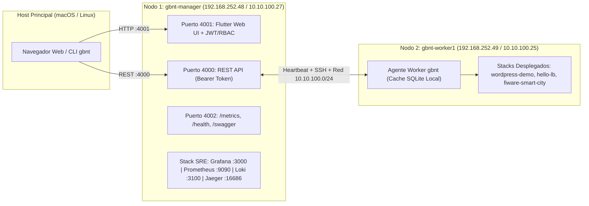

---

## 2. Instalación, Inicialización y Unión de Nodos (`gbnt legion`)

### 2.1 Descarga e Instalación del Binario Único (`gbnt`)

El mismo binario `gbnt` actúa como **Manager**, **Worker** y **Cliente CLI**:

```bash
# Linux (ARM64 / AMD64)
ARCH=$(uname -m | sed 's/x86_64/amd64/;s/aarch64/arm64/')
curl -sSL "https://github.com/gubernator-org/gubernator/releases/latest/download/gbnt-linux-${ARCH}" -o /usr/local/bin/gbnt
chmod +x /usr/local/bin/gbnt
gbnt version
```

### 2.2 Provisión Automática del Clúster de 2 Nodos en el Host

Para recrear o levantar automáticamente el clúster completo de 2 máquinas sobre el host:

```bash
# Compilar binario para los nodos Linux ARM64 y lanzar script de provisión
GOOS=linux GOARCH=arm64 CGO_ENABLED=0 go build -ldflags "-s -w -X main.version=$(cat VERSION)" -o bin/gbnt-linux-arm64 ./cmd/gbnt
./scripts/recreate-cluster-2nodes.sh
```

### 2.3 Inicialización Manual de un Clúster (`Manager` + `Worker`)

1. **En `gbnt-manager` (`192.168.252.48`) — Inicializar el Manager:**
   ```bash
   export GBNT_API_TOKEN="my-gubernator-api-token"
   gbnt legion init --advertise-addr 192.168.252.48
   ```
2. **En `gbnt-manager` — Obtener el token de unión para Workers:**
   ```bash
   gbnt legion join-token
   ```
3. **En `gbnt-worker1` (`192.168.252.49`) — Unirse al clúster como Centurion Worker:**
   ```bash
   export GBNT_API_TOKEN="my-gubernator-api-token"
   gbnt legion join 192.168.252.48:4000 \
     --token "<JOIN_TOKEN>" \
     --node-id "node-gbnt-worker1" \
     --advertise-addr "192.168.252.49"
   ```
4. **Verificar el estado de los nodos desde la CLI:**
   ```text
   $ gbnt node ls
   ID                   IP               ROLE      STATUS   CPU    MEMORY   HOST DISK                
   node-local-manager   192.168.252.48   manager   active   0.0%   -        25% (6.9 GB / 28.0 GB)   
   node-gbnt-worker1    192.168.252.49   worker    active   0.0%   -        45% (8.3 GB / 18.3 GB)   
   ```

---

## 3. Acceso al Dashboard Web y Control de Identidad

Accede desde tu navegador al puerto `4001` del nodo Manager:
👉 **`http://192.168.252.48:4001`**

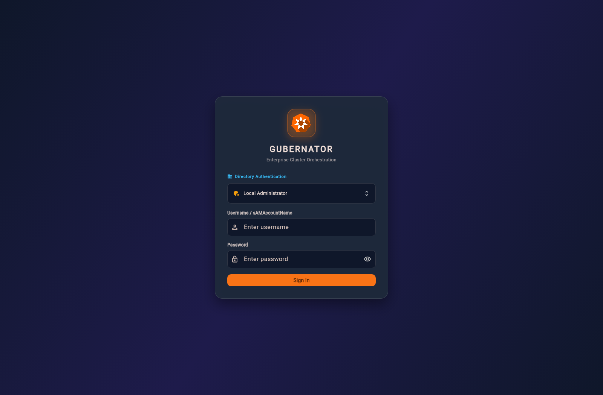

* **Credenciales iniciales por defecto:** Usuario `admin` / Contraseña `admin`.
* **Autenticación Empresarial:** Soporta integración nativa con múltiples servidores **Active Directory / OpenLDAP** (LDAPS `636` y StartTLS), **SSO / OIDC**, segundo factor **MFA TOTP (ENS)** y control de acceso basado en roles (**RBAC**: `admin`, `operator`, `readonly`).

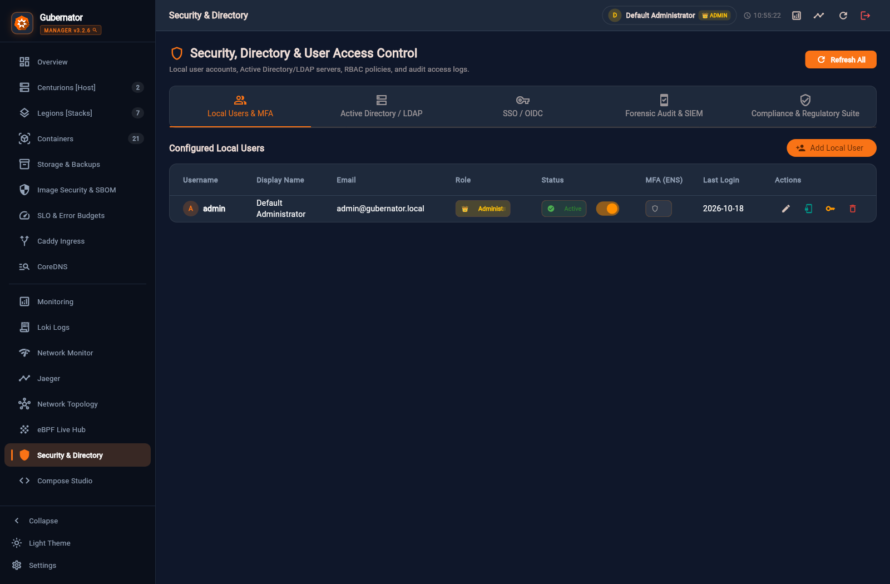

---

## 4. Vista General del Clúster (`Overview`)

Al iniciar sesión se muestra el panel principal **Overview**, que ofrece una radiografía instantánea del estado de las dos máquinas del clúster:

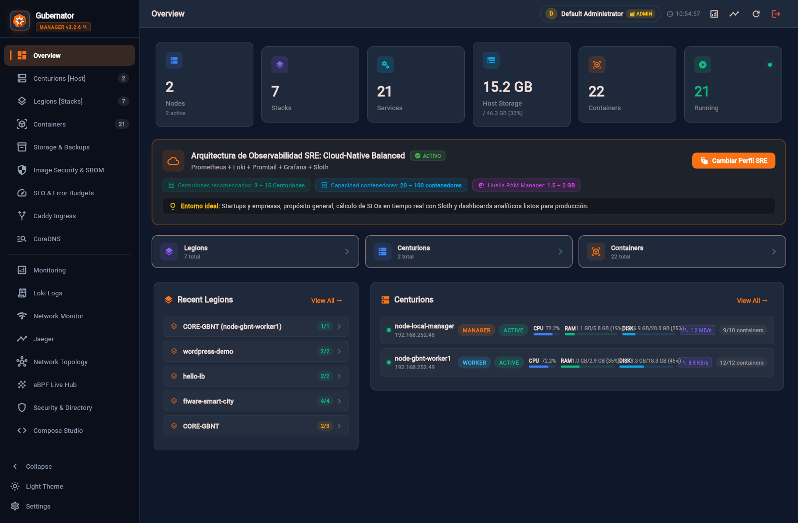

### Elementos clave de `Overview`:
* **Tarjetas KPI Superiores:**
  * **Nodes (`2 active`):** Muestra los nodos activos del clúster (`node-local-manager` y `node-gbnt-worker1`).
  * **Stacks (`7`):** Total de pilas desplegadas (aplicaciones de usuario + stacks base del sistema).
  * **Services (`21`) & Containers (`22` / `21 Running`):** Recuento en tiempo real de servicios y contenedores activos.
  * **Host Storage (`15.2 GB / 46.3 GB`):** Capacidad agregada de disco físico de todos los hosts del clúster.
* **Arquitectura de Observabilidad SRE:** Indica el perfil activo (**Cloud-Native Balanced**: Prometheus + Loki + Promtail + Grafana + Sloth) y permite cambiar en vivo entre los perfiles `Ultra-Light`, `Cloud-Native Balanced` y `Enterprise ELK/OpenSearch` mediante el botón **Cambiar Perfil SRE**.
* **Paneles Inferiores (`Recent Legions` y `Centurions`):** Muestran en proporción 1/3 vs 2/3 las pilas recientes y las barras térmicas de uso de **CPU, RAM, Disco Host y Tráfico de Red** de `192.168.252.48` y `192.168.252.49`.

---

## 5. Gestión de Nodos del Clúster (`Centurions [Host]`)

La sección **Centurions [Host]** permite administrar todos los servidores físicos o virtuales unidos al clúster:

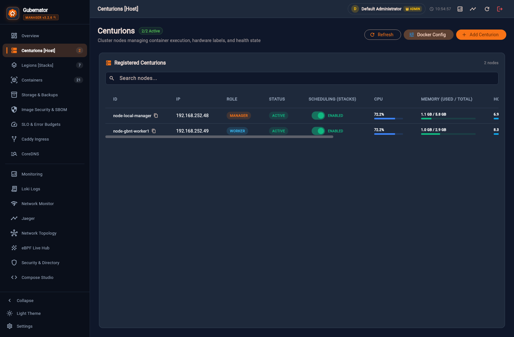

### Funcionalidades disponibles:
* **Estado y Planificación (`Scheduling`):** Permite activar o pausar (`ENABLED` / `PAUSED` / `DRAIN`) la asignación de contenedores en cada nodo con un interruptor directo.
* **Telemetría por Host:** Visualiza el consumo en tiempo real de CPU (`%`), Memoria RAM (`1.1 GB / 5.8 GB` en Manager, `1.0 GB / 2.9 GB` en Worker 1) y Disco Host.
* **Etiquetas de Hardware y IA (`Labels`):** Permite añadir etiquetas como `gbnt.node.gpu=nvidia`, `gbnt.node.zone=eu-west` o `gbnt.node.storage=ssd` para dirigir cargas mediante `deploy.placement.constraints`.
* **Configuración del Demonio Docker (`Docker Config`):** Edita y sincroniza `/etc/docker/daemon.json` (registros inseguros, espejos, rotación de logs, métricas expuestas) en cualquiera de los nodos sin necesidad de entrar por SSH manual.
* **Añadir Centurión (`+ Add Centurion`):** Asistente guiado para incorporar nuevos nodos al clúster.

---

## 6. Despliegue de Stacks (`Legions`) y `Compose Studio`

### 6.1 Panel de `Legions [Stacks]`

En **Legions [Stacks]** se gestionan las aplicaciones multicontenedor desplegadas mediante archivos `docker-compose.yml`:

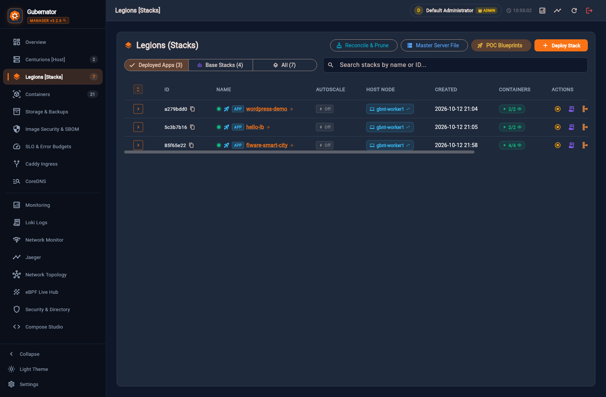

* **Filtro por Tipo:** Separa **Deployed Apps (`3`)** (`wordpress-demo`, `hello-lb`, `fiware-smart-city`) de **Base Stacks (`4`)** (`CORE-GBNT` y `[SRE] Monitor` en Manager y Worker).
* **Residencia de Nodo (`HOST NODE`):** Muestra en qué Centurión se ejecutan los contenedores de cada Stack (por ejemplo, `gbnt-worker1`).
* **Acciones Rápidas:**
  * 🚀 **POC Blueprints:** Catálogo de arquitecturas listas para desplegar en un clic (WordPress + MySQL, n8n AI, JupyterLab LLM, Kubeflow, FIWARE Smart City, SCADA FUXA).
  * 🧹 **Reconcile & Prune:** Reconcilia el estado deseado frente al motor Docker y limpia contenedores huérfanos.
  * ➕ **Deploy Stack:** Despliega un nuevo `docker-compose.yml` pegando el YAML o subiendo el archivo.

### 6.2 `Compose Studio` & Gubernator Copilot

La vista **Compose Studio** proporciona un entorno IDE completo dentro del navegador para editar stacks en caliente:

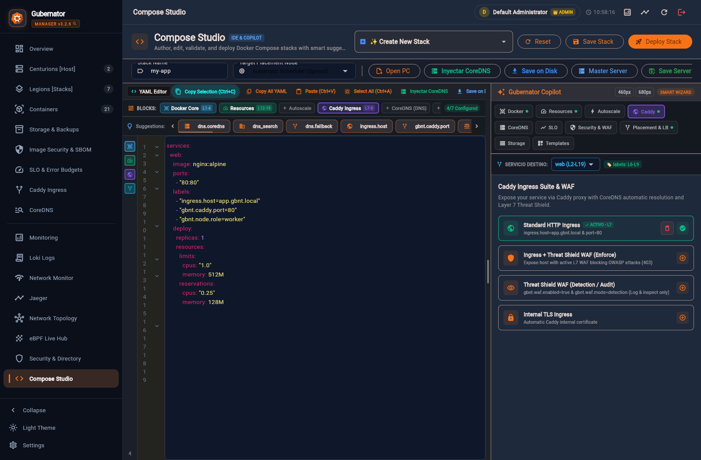

* **Barra de Sugerencias Inteligentes:** Inserta etiquetas nativas de Gubernator con un clic (`ingress.host`, `gbnt.caddy.port`, `gbnt.slo.*`, `gbnt.security.*`, `deploy.placement`, `/var/contenedores/`).
* **Gubernator Copilot (Panel Lateral):** Asistente visual de 6 pestañas para configurar **Caddy Ingress**, **Sloth SLOs**, **Security Gatekeeper**, **Afinidad de Nodos Centurion** y **Almacenamiento Persistente** sin memorizar la sintaxis YAML.

---

## 7. Gestión de Contenedores y Carga de Trabajo (`Containers`)

La pestaña **Containers (Cohorts & Workloads)** lista todos los contenedores en ejecución a lo largo del Manager y los Workers:

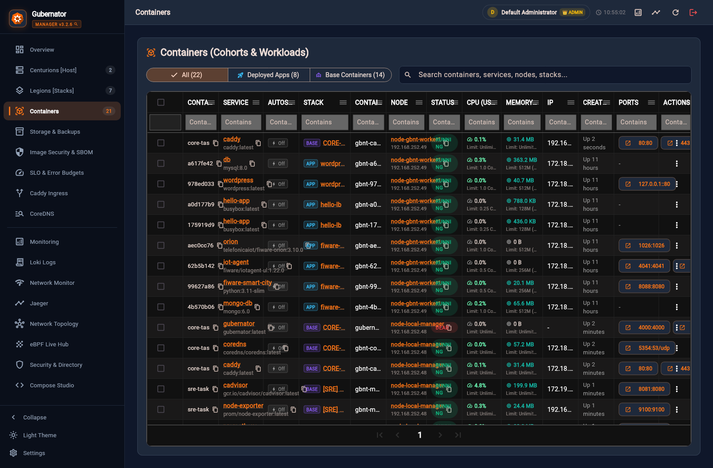

### Capacidades operativas:
* **Filtros por Columna y Búsqueda Global:** Filtra instantáneamente por nombre de contenedor, servicio, stack (`wordpress-demo`, `fiware-smart-city`, `hello-lb`), nodo (`192.168.252.48` o `192.168.252.49`), estado (`RUNNING` / `DEAD`) o IP interna.
* **Chips de Puertos Clicables (`PORTS`):** Haz clic sobre cualquier puerto mapeado (ej. `80:80`, `1026:1026`, `4041:4041`, `8088:8080`, `8081:8080`) para abrir directamente el servicio en una nueva pestaña del navegador apuntando a la IP del nodo correspondiente.
* **Operaciones en Lote (Bulk Actions):** Selecciona múltiples contenedores mediante las casillas de verificación para iniciarlos, detenerlos, reiniciarlos o eliminarlos simultáneamente.
* **Consola Interactiva y Logs:** Desde el menú de acciones (`⋮`) de cada contenedor puedes abrir una **Terminal Web (`sh`/`bash`) en vivo**, inspeccionar sus logs o ver sus métricas individuales de CPU y RAM.

---

## 8. Almacenamiento Persistente, GlusterFS y Backups (`The Granaries`)

El subsistema **Storage & Backups (`The Granaries`)** centraliza la persistencia de datos en todo el clúster:

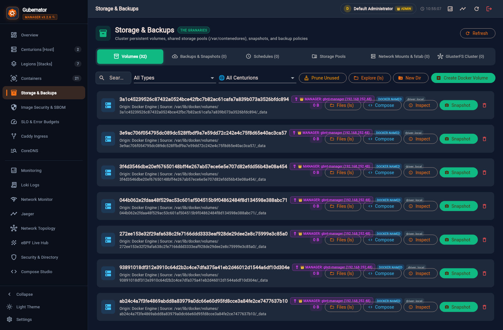

### 6 Sub-pestañas especializadas:
1. **Volumes (`32`):** Descubre todos los volúmenes nombrados de Docker y directorios compartidos en `gbnt-manager` y `gbnt-worker1`, mostrando su insignia de residencia de host (`👑 MANAGER` o `🛡️ WORKER`). Incluye:
   * **Files (`ls`):** Explorador interactivo de archivos y carpetas dentro del volumen en cualquier nodo.
   * **Compose:** Genera el fragmento exacto de `volumes:` para copiar y pegar en `docker-compose.yml`.
   * **Snapshot:** Crea una copia de seguridad inmediata del volumen.
2. **Backups & Snapshots:** Crea archivos comprimidos `.tar.gz` con suma criptográfica **SHA-256**, opción de congelación consistente (`docker pause` durante el empaquetado para bases de datos SQL), descarga directa al navegador y restauración en un clic.
3. **Schedules:** Programación automática de copias de seguridad mediante expresiones Cron y políticas de retención.
4. **Storage Pools:** Matriz de diagnóstico que verifica permisos de lectura/escritura y espacio libre en `/var/contenedores` en todos los nodos.
5. **Network Mounts & `fstab`:** Asistente para montar recursos **NFS (v3/v4)**, **Samba/CIFS**, **S3 Object Storage (`s3fs`)** y **GlusterFS**, sincronizando de forma segura `/etc/fstab` en todos los hosts.
6. **GlusterFS Cluster:** Gestión de volúmenes distribuidos/replicados sobre la red dedicada `10.10.100.0/24` (`10.10.100.27` ↔ `10.10.100.25`) con auto-montaje en `/var/contenedores` y diagnóstico de *split-brain*.

---

## 9. Seguridad de Imágenes, SBOM, Firma Cosign y Cumplimiento Normativo

### 9.1 `Image Security & SBOM` (`The Imperial Seal`)

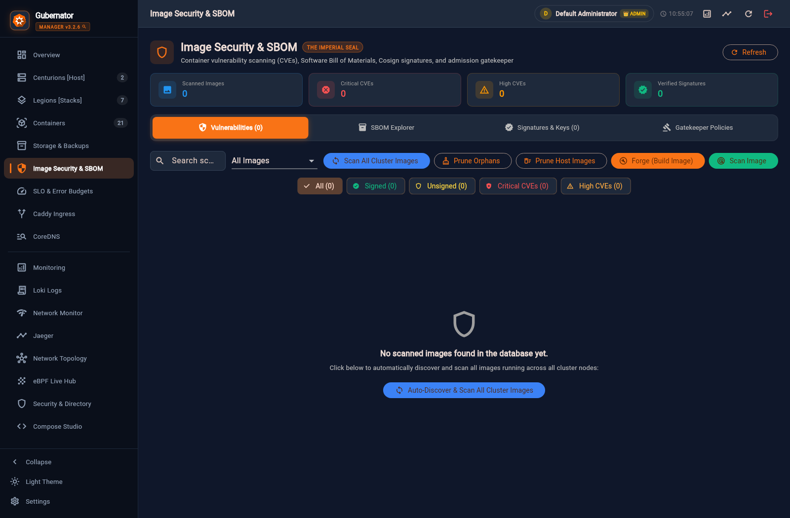

* **Vulnerability Scanner:** Analiza las imágenes desplegadas en el clúster en busca de CVEs (`CRITICAL`, `HIGH`, `MEDIUM`, `LOW`) indicando el paquete afectado y la versión que lo corrige.
* **SBOM (Software Bill of Materials):** Genera inventarios completos de dependencias y licencias en formatos estándar **CycloneDX JSON** y **SPDX JSON**.
* **Cosign Cryptographic Signing:** Genera pares de claves ECDSA P-256 en el clúster para firmar criptográficamente imágenes de contenedores y verificar su autenticidad.
* **Admission Gatekeeper:** Controlador de admisión pre-despliegue capaz de bloquear automáticamente contenedores no firmados o con vulnerabilidades críticas sin parchear.

### 9.2 `Compliance & Regulatory Suite`

Dentro de **Security & Directory ➔ Compliance & Regulatory Suite**, Gubernator audita continuamente el clúster frente a los principales marcos regulatorios europeos e internacionales:

* **🇪🇺 EU DORA (Reglamento 2022/2554):** Resiliencia operativa digital para entidades financieras y tecnológicas.
* **🇪🇺 Directiva NIS 2 (UE 2022/2555):** Ciberseguridad para infraestructuras críticas y servicios esenciales.
* **🇪🇸 Esquema Nacional de Seguridad (ENS — RD 311/2022):** Controles técnicos de acceso, bloqueo de cuenta, caducidad de sesión por inactividad (`op.acc.2`) y trazabilidad forense.
* **🌐 ISO/IEC 27001:2022 (Anexo A) & CIS Docker Benchmark v1.6.0:** Auditoría automatizada de endurecimiento del host Linux y del motor Docker con remediación en un clic.

---

## 10. Ingress Multi-Nodo (`Caddy`) y Descubrimiento DNS (`CoreDNS`)

### 10.1 `Caddy Ingress Suite`

Gubernator gestiona instancias de **Caddy** en todos los nodos del clúster como puerta de enlace inversa HTTPS y balanceador de carga:

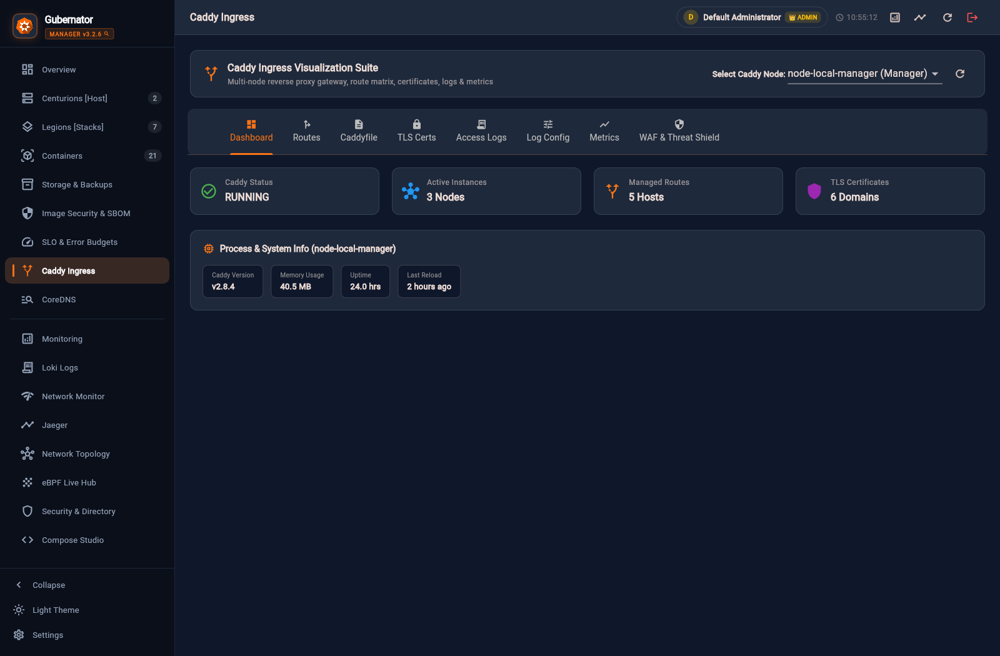

* **7 Pestañas de Control:** `Dashboard`, `Routes`, `Caddyfile`, `TLS Certs`, `Access Logs`, `Log Config`, `Metrics` y `WAF & Threat Shield`.
* **Enrutamiento Automático por Etiquetas Compose:** Basta con añadir `ingress.host: mi-app.gbnt.local` y `gbnt.caddy.port: "8080"` en un servicio de `docker-compose.yml` para que Gubernator configure la ruta inversa y el certificado TLS automáticamente.
* **WAF & Threat Shield:** Protección integrada contra SQL Injection (SQLi), Cross-Site Scripting (XSS), Path Traversal, escáneres maliciosos y límite de tasa (*Rate Limiting*) por IP.

### 10.2 `CoreDNS Management Suite`

Proporciona resolución DNS interna y de clúster para todos los contenedores y hosts bajo el dominio `gbnt.local`:

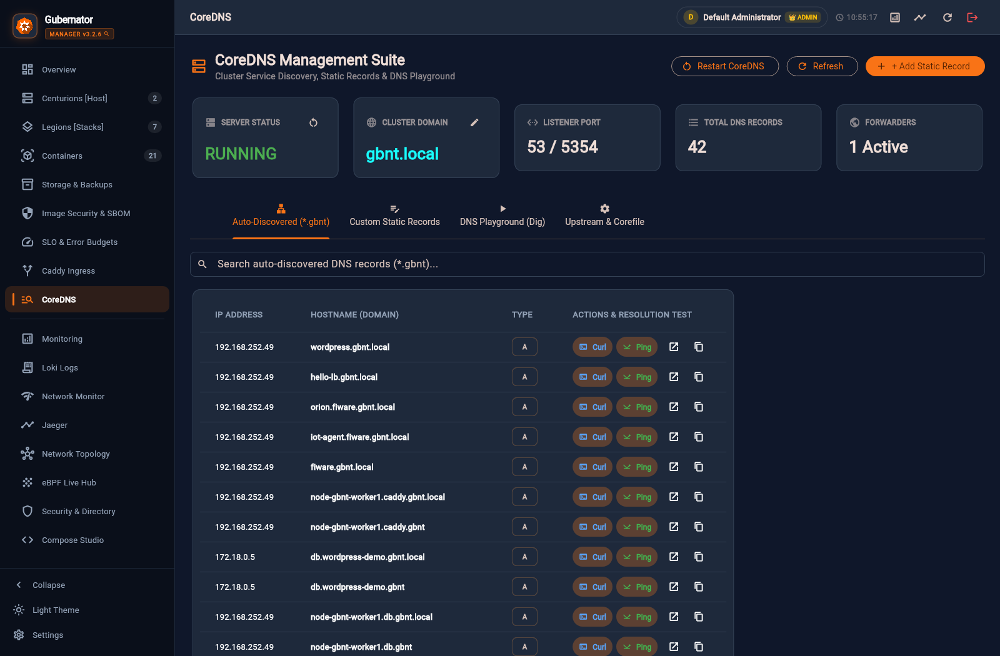

* **Auto-Discovered (`*.gbnt` / `*.gbnt.local`):** Registra automáticamente cada servicio desplegado (ej. `wordpress.gbnt.local`, `hello-lb.gbnt.local`, `orion.fiware.gbnt.local`, `fiware.gbnt.local` apuntando a `192.168.252.49`) y permite probar conectividad con botones directos de **Curl** y **Ping**.
* **Custom Static Records & DNS Playground (`Dig`):** Crea registros `A`, `AAAA`, `CNAME`, `TXT` o `SRV` personalizados y ejecuta consultas `dig` de diagnóstico desde la propia interfaz web.

---

## 11. Observabilidad SRE: Grafana, Loki Logs, SLOs y `eBPF Live Hub`

### 11.1 `Monitoring` (Dashboards de Grafana en Vivo)

La pestaña **Monitoring** incrusta los cuadros de mando de **Grafana** alimentados por **Prometheus**, **cAdvisor** y **Node Exporter** de todos los nodos del clúster:

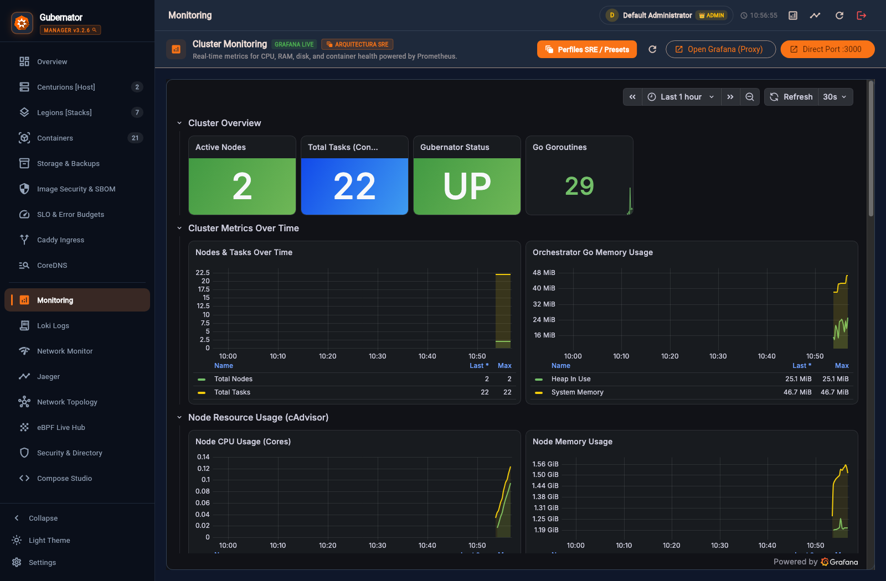

### 11.2 `Loki Logs Explorer` (Agregación Centralizada de Logs)

El explorador **Loki Logs** permite consultar y filtrar en tiempo real todos los logs recolectados por **Promtail** en `gbnt-manager` y `gbnt-worker1` por nodo, contenedor, nivel (`ERROR`, `WARN`, `INFO`), flujo (`stdout`, `stderr`), ventana temporal y expresiones regulares, con modo **Live Tail** y exportación directa a `.log`:

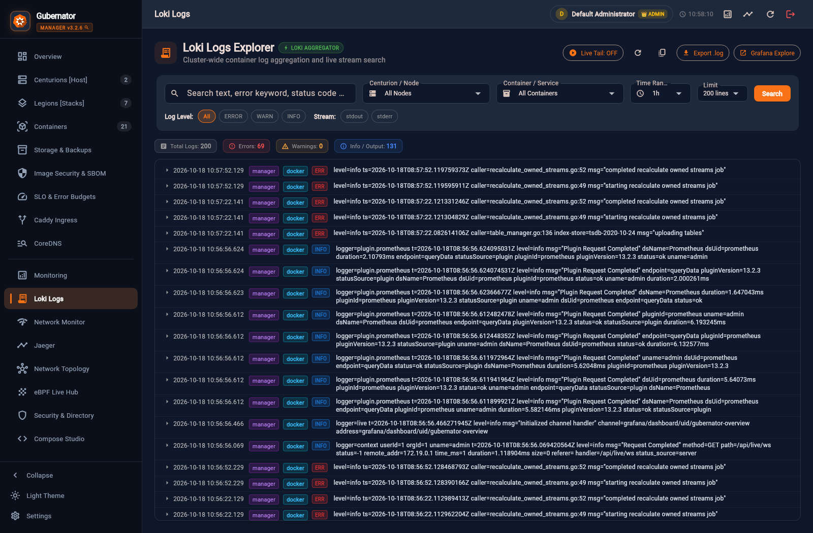

### 11.3 `SLO & Error Budgets` (Motor Google SRE Sloth)

Permite definir Objetivos de Nivel de Servicio (**SLOs**) basados en disponibilidad o latencia y monitorizar el consumo del **Error Budget** con alertas *Multi-Burn-Rate*:

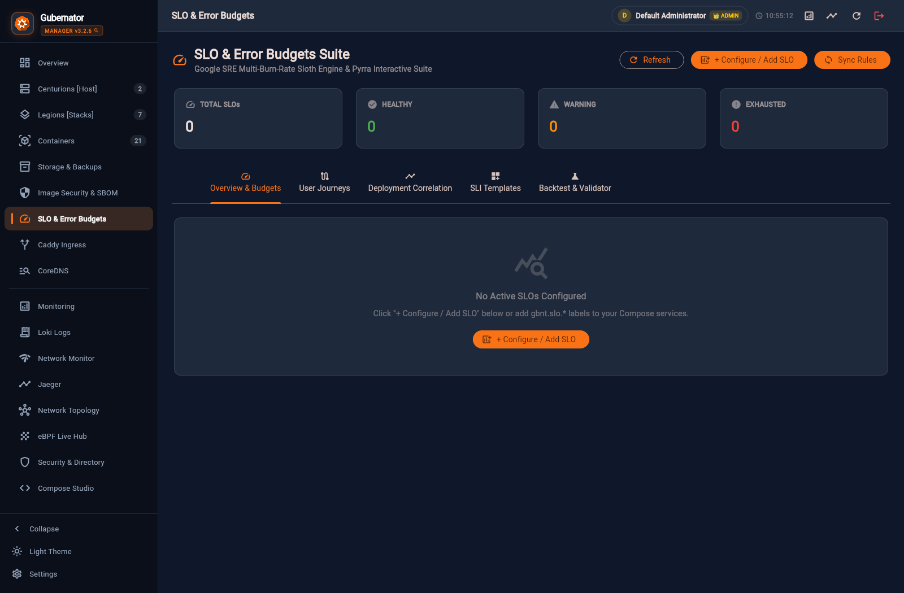

### 11.3 `eBPF Live Hub & Kernel Observability`

El panel **eBPF Live Hub** inspecciona en tiempo real los flujos de red L4/L7 directamente desde el kernel Linux (`6.8.0-146-generic`) sin necesidad de instrumentar ni modificar el código de las aplicaciones:

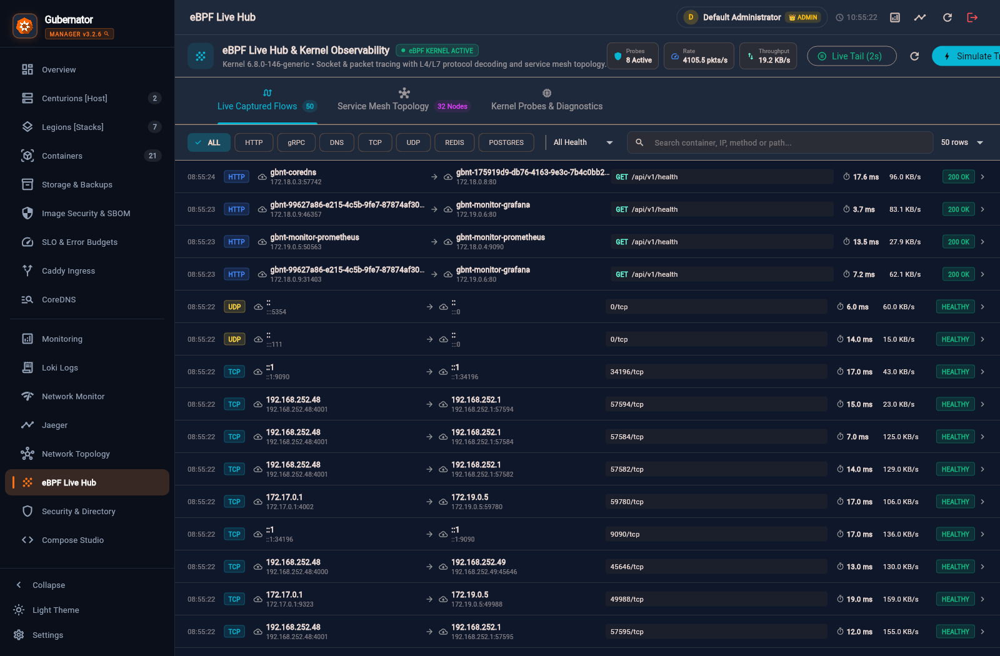

* **Live Captured Flows:** Decodifica peticiones `HTTP`, `gRPC`, `DNS`, `TCP`, `UDP`, `REDIS` y `POSTGRES` mostrando contenedor origen/destino, latencia en milisegundos, ancho de banda (`KB/s`) y código de estado (`200 OK` / `HEALTHY`).
* **Service Mesh Topology & Kernel Probes:** Construye automáticamente el mapa de dependencias entre microservicios a partir del tráfico real observado en el kernel.

---

## 12. Guía Rápida de Comandos CLI (`gbnt`)

Todos los subsistemas del Dashboard cuentan con paridad completa desde la línea de comandos mediante el binario `gbnt`:

```bash
# Configuración del token de API
export GBNT_API_TOKEN="my-gubernator-api-token"

# 1. Gestión de Clúster y Nodos (Centurions)
gbnt legion init --advertise-addr 192.168.252.48
gbnt legion join-token
gbnt node ls
gbnt node label node-gbnt-worker1 gpu=nvidia zone=eu-1

# 2. Gestión de Stacks (Legions) y Contenedores (Tasks)
gbnt stack deploy -c docker-compose.yml mi-stack
gbnt stack ls
gbnt task ls
gbnt task logs <task-id>

# 3. Almacenamiento, Volúmenes, Montajes y GlusterFS (The Granaries)
gbnt volume ls
gbnt backup create <volume-name> --freeze
gbnt backup ls
gbnt mount ls
gbnt gluster status
gbnt gluster volume ls

# 4. Seguridad de Imágenes, SBOM y Firma Criptográfica
gbnt scan nginx:latest
gbnt sbom nginx:latest --format cyclonedx
gbnt security key generate
gbnt image sign nginx:latest

# 5. Observabilidad SRE y SLOs
gbnt monitor init
gbnt monitor status
gbnt slo ls
gbnt slo sync

# 6. Versión y Métricas Públicas de Adopción
gbnt version --metrics
```

---

> 📌 **Repositorio Oficial:** [https://github.com/gubernator-org/gubernator](https://github.com/gubernator-org/gubernator)  
> 📖 **Documentación Online (GitHub Pages):** [https://gubernator-org.github.io/gubernator/](https://gubernator-org.github.io/gubernator/)
